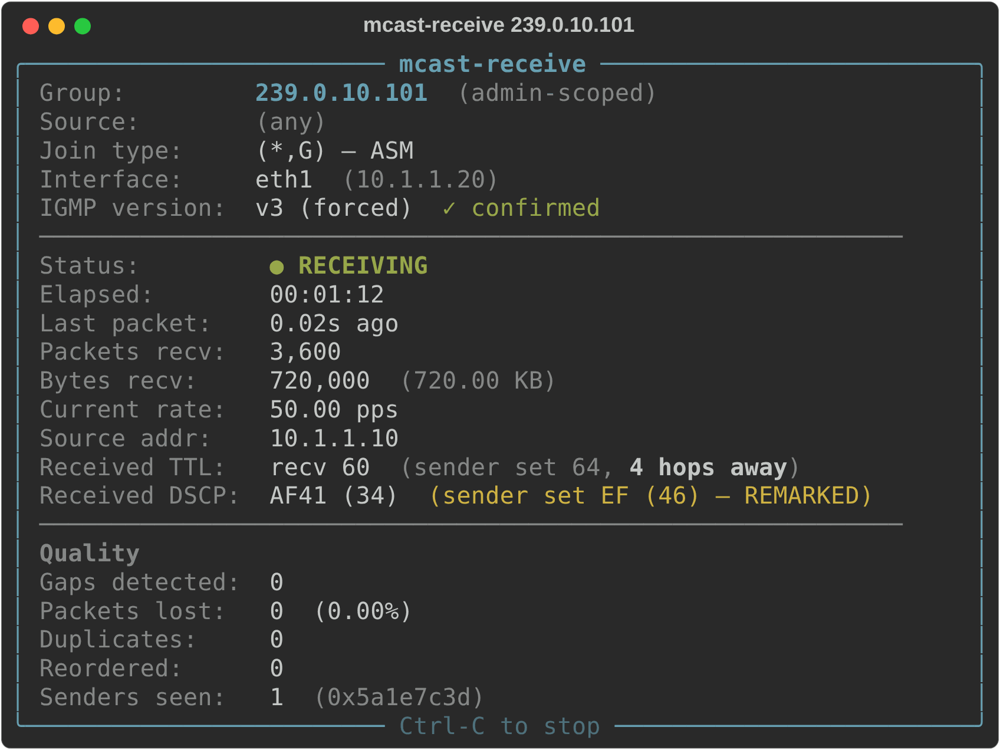

# mcast-tools

**Multicast you can see.** Send and receive IPv4 and IPv6 multicast on
**Linux and Windows**, with live dashboards that show loss, duplicates and
reordering as they happen, plus hop count and DSCP remarking on Linux
receivers.

```bash
pipx install mcast-tools    # or: pip install mcast-tools
```



## Why mcast-tools?

`iperf` can push multicast. `mcast-tools` shows you what the network did to
it:

- **Live dashboards.** Status, rate, loss, duplicates, reordering and
  stalls, updated in real time.
- **Hop count and DSCP remark detection.** Every packet carries the TTL and
  DSCP its sender set, so a Linux receiver shows how far it travelled and
  whether anything on the path re-marked it.
- **ASM and SSM.** Any-source `(*,G)` and source-specific `(S,G)` joins,
  with the IGMPv3/MLDv2 rules enforced and explained.
- **IGMP/MLD version control.** Force IGMPv1–3 or MLDv1–2 on an interface
  for the length of a run, restored on exit (Linux, as root).
- **IPv4 and IPv6, auto-detected.** The group decides: `239.0.10.101` is
  IPv4, `ff3e::8000:1` is IPv6. No flags.
- **Script-friendly.** `--quiet` and `--json` give one-line summaries for
  automation.

## Quick start

No lab needed: two terminals on one machine will do. In the first:

```bash
mcast-receive 239.0.10.101
```

In the second, or on another host:

```bash
mcast-send 239.0.10.101
```

Receiving on Windows? Allow inbound UDP port 19779 in Windows Defender
Firewall first, with [one PowerShell command](https://github.com/mitchv85/mcast-tools/blob/main/docs/guide.md#windows).

A few more to try:

```bash
# SSM: accept one source only (pin the sender's source to match)
mcast-receive 232.1.1.1 --source 10.1.1.10
mcast-send 232.1.1.1 --source 10.1.1.10

# The same over IPv6, with MLDv2
mcast-receive ff3e::8000:1 --source 2001:db8::5
mcast-send ff3e::8000:1 --source 2001:db8::5

# Mark traffic EF; a Linux receiver flags any remarking along the path
mcast-send 239.0.10.101 --rate 1Mbps --dscp ef --ttl 64

# Which groups is this host joined to? (Linux)
mcast-status
```

Every command has `--help` listing all of its options.

## The tools

| Command | What it does |
|---|---|
| `mcast-send` | Streams multicast at your chosen rate, size, TTL and DSCP |
| `mcast-receive` | Joins ASM or SSM and runs the live dashboard |
| `mcast-status` | Lists the host's group memberships (Linux) |

## Linux and Windows

`mcast-send` and `mcast-receive` run natively on both. On Windows 11,
`mcast-receive` is verified with Linux senders over IPv4 and IPv6, ASM and
SSM, and `mcast-send` over IPv4.

Linux-only for now: `mcast-status`, IGMP/MLD version forcing, hop count and
DSCP remark detection on the receiving side, choosing the interface
(Windows uses its default one; IPv6 receivers can take an interface
index), and sending to link-local IPv6 groups.

## Learn more

The [guide](https://github.com/mitchv85/mcast-tools/blob/main/docs/guide.md)
covers every option, IPv6 scopes and zones, SSM source pinning, the Windows
details and what's on the wire.

Python 3.10+. MIT licensed.
